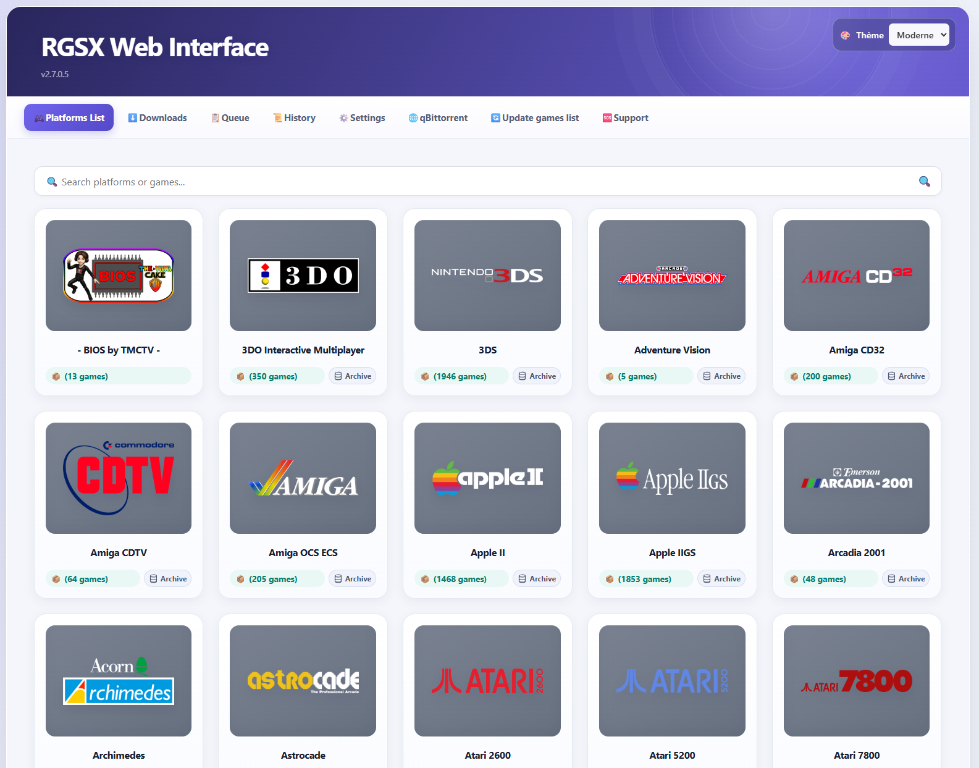
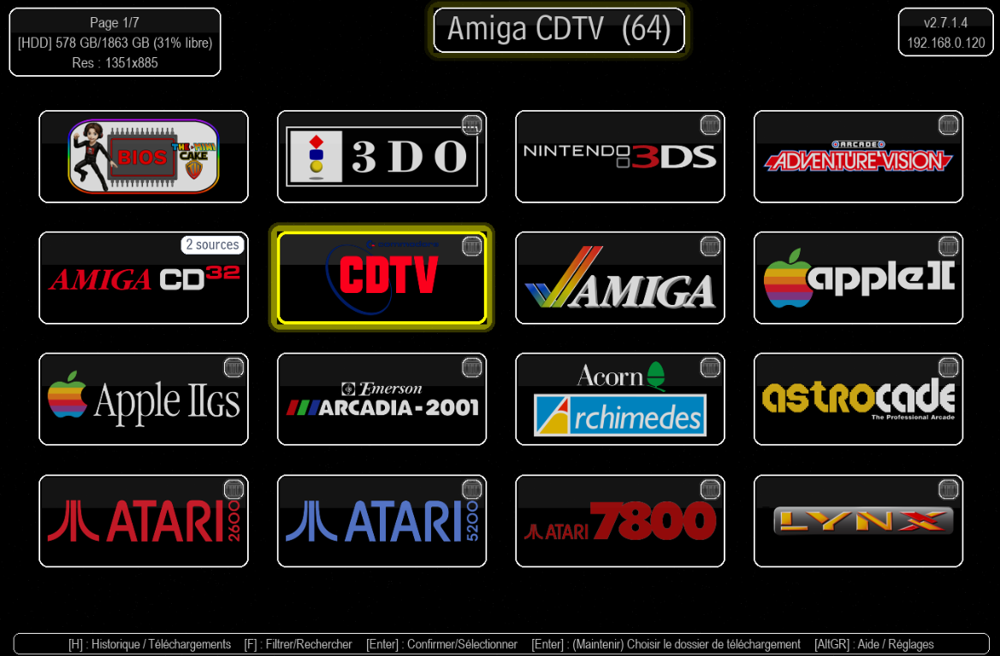
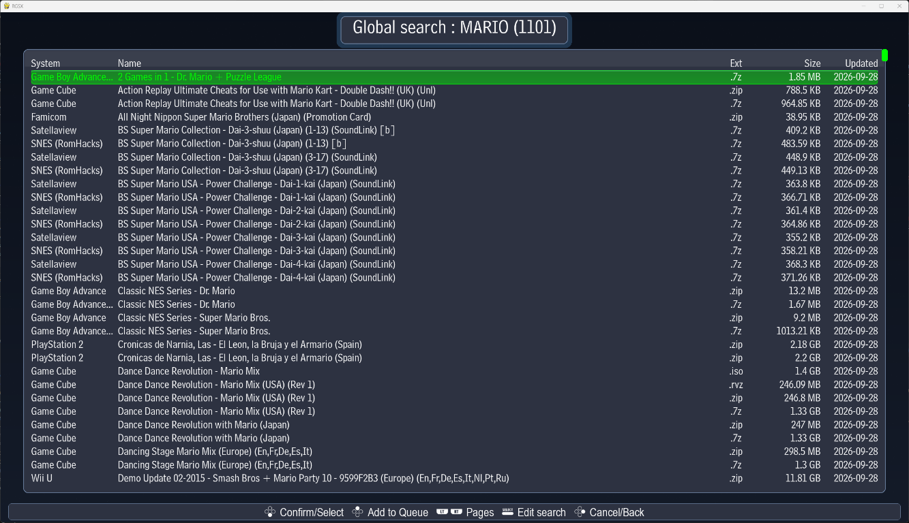
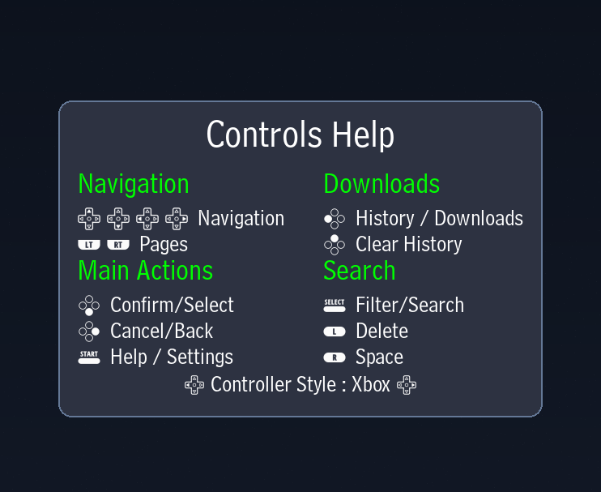
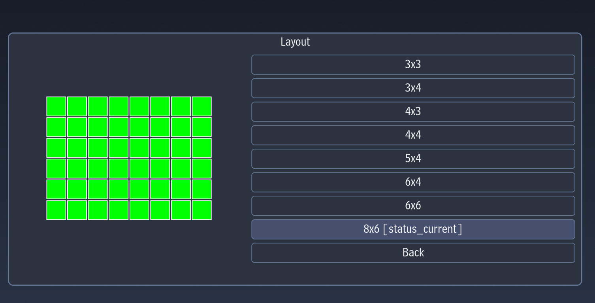
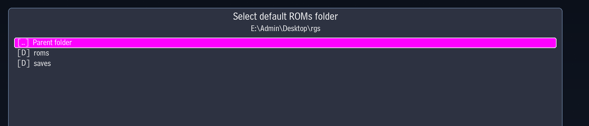
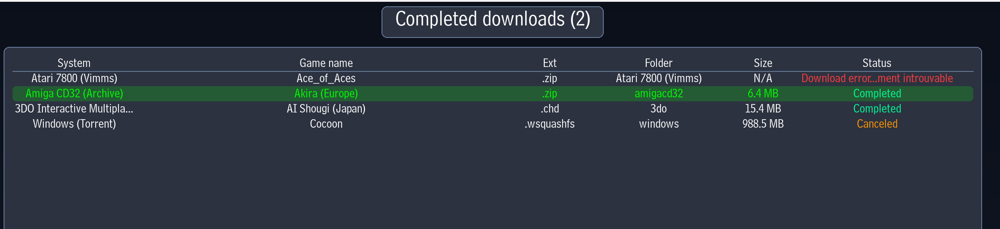
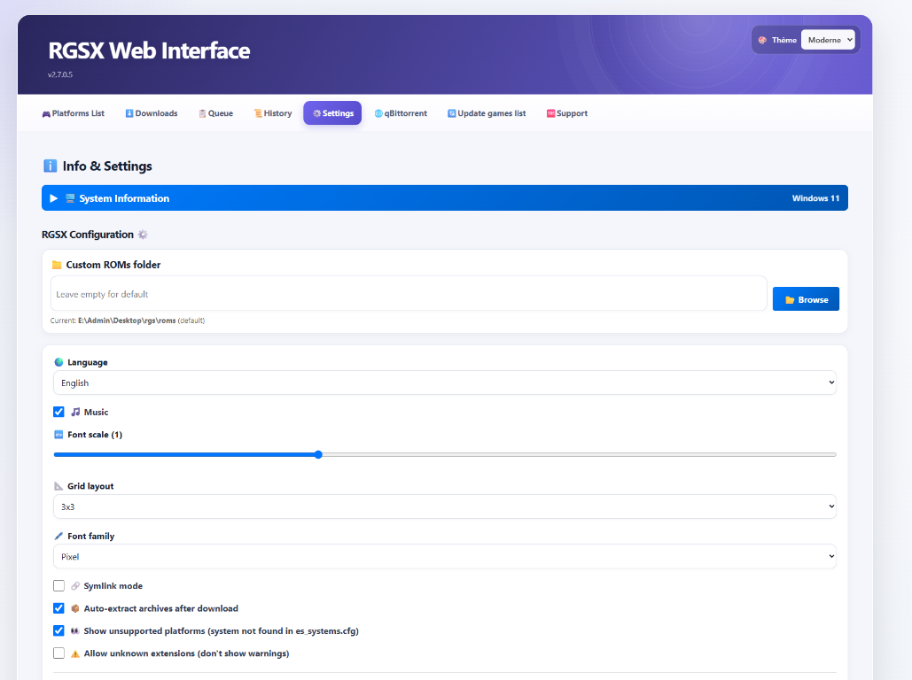

# 🎮 Retro Game Sets Xtra (RGSX)

**[Support Discord](https://discord.gg/Vph9jwg3VV)** • **[Installation](#-installation)** • **[Documentation anglaise](https://github.com/RetroGameSets/RGSX/blob/main/README.md)** • **[Documentation turque](https://github.com/RetroGameSets/RGSX/blob/main/README_TR.md)** • **[Dépannage / Erreurs courantes](https://github.com/RetroGameSets/RGSX/blob/main/README_FR.md#%EF%B8%8F-d%C3%A9pannage)** •

Un téléchargeur de ROMs gratuit et simple d'utilisation pour Batocera, Knulli et RetroBat, avec support multi-sources.

<p align="center">
  
  
</p>
<p align="center">
  
  
</p>
<p align="center">
  
  
</p>
<p align="center">
  
  
</p>


---

## 🚀 Installation

### Installation rapide (Batocera / Knulli)

**Accès SSH ou Terminal requis :**
```bash
curl -L bit.ly/rgsx-install | sh
```

Après installation :
1. Mettez à jour les listes de jeux : `Menu > Paramètres des jeux > Mettre à jour la liste des jeux`
2. Trouvez RGSX dans **PORTS** ou **Homebrew and ports**

### Installation manuelle (Tous systèmes)
1. **Télécharger** : [RGSX_full_latest.zip](https://github.com/RetroGameSets/RGSX/releases/latest/download/RGSX_full_latest.zip)
2. **Extraire** :
   - **Batocera/Knulli** : extraire le dossier `ports` dans `/roms/`
   - **RetroBat** : extraire les dossiers `ports` et `windows` dans `/roms/`
3. **Rafraîchir** : `Menu > Paramètres des jeux > Mettre à jour la liste des jeux`

### Mise à jour manuelle (si la mise à jour automatique a échoué)
Télécharger et extraire la dernière release : [RGSX_full_latest.zip](https://github.com/RetroGameSets/RGSX/releases/latest/download/RGSX_full_latest.zip)

**Chemins installés :**
- `/roms/ports/RGSX` (tous systèmes)
- `/roms/windows/RGSX` (RetroBat uniquement)

---

## 🎮 Utilisation

### Premier lancement

- Synchronise le catalogue des systèmes et des jeux dans sa base SQLite locale
- Télécharge les images nécessaires à l'interface
- Configure automatiquement les contrôles si votre manette est reconnue
- **Contrôles cassés ?** Supprimez `/saves/ports/rgsx/controls.json` puis redémarrez

**Retrobat / premier lancement Windows**

- Il est recommandé de lancer une première fois `RGSX Retrobat.bat` manuellement, hors interface Retrobat, pour valider l’environnement.
- Autorisez les demandes Windows de pare-feu quand elles apparaissent, surtout pour qBittorrent au premier lancement.
- Retrobat masque certaines fenêtres système par défaut : un premier lancement manuel évite de manquer une invite importante.
- Le lanceur configure ensuite une règle locale pour le binaire qBittorrent intégré et pour la WebUI TCP `18572`.

**Mode clavier** : lorsqu'aucune manette n'est détectée, les contrôles s'affichent sous forme de `[Touche]` au lieu d'icônes.

### Structure du menu pause

**Menu racine** — Jeux, Langue, Contrôles, Affichage, Paramètres, Support, Réinitialiser les paramètres par défaut et Quitter. Scrap est provisoirement masqué (voir ci-dessous).

- **Jeux** : actualiser le catalogue, scanner les ROMs déjà présentes, ouvrir l'historique, afficher/masquer les systèmes non supportés et choisir les plateformes visibles.
- **Contrôles** : consulter l'aide des commandes actuellement assignées ou remapper clavier/manette.
- **Affichage** : choisir parmi huit grilles (3×3, 3×4, 4×3, 4×4, 5×4, 6×4, 6×6 ou 8×6), régler séparément la taille de police de l'interface et du pied de page, choisir la police (Pixel, Bell Centennial ou DejaVu Sans), le thème d'arrière-plan et le mode léger. Le choix du moniteur n'apparaît que si plusieurs écrans sont détectés ; le mode fenêtre/plein écran est réservé à Windows. Le menu permet aussi de masquer l'avertissement d'extension inconnue.
- **Scrap** (provisoirement masqué) : modifier les identifiants ScreenScraper et ouvrir le Gestionnaire de médias.
- **Paramètres** : musique, comportement des liens symboliques, extraction automatique, dossier ROMs, nombre maximal de téléchargements simultanés, statut des clés API et état des connexions. Le service Web au démarrage et le DNS personnalisé sont proposés sous Linux/Batocera.
- **Support** : outils de diagnostic et génération d'une archive de support.
- **Quitter** : quitter ou redémarrer RGSX. La langue se choisit directement depuis le menu racine.

### ScreenScraper et Gestionnaire de médias

> **Désactivation provisoire.** RGSX n'appelle pas l'API ScreenScraper pour le moment, le temps de vérifier l'attribution des quotas de compte :
> - la liste des jeux n'affiche que les pochettes déjà présentes dans le cache média local ; aucune requête n'est envoyée à la sélection d'un jeu ;
> - le menu **Scrap** est masqué, ainsi que le Gestionnaire de médias qui n'est accessible que depuis ce menu ;
> - l'appui de deux secondes sur **Valider** n'ouvre plus les détails ScreenScraper, et l'entrée **Scraper** des options de l'historique est masquée.
>
> Pour réactiver ces fonctions, passez `SCREENSCRAPER_TEMPORARILY_DISABLED` à `False` dans `config.py`. Le comportement décrit ci-dessous s'applique alors à nouveau.

Dans la liste des jeux, laisser un jeu sélectionné pendant deux secondes récupère sa pochette dans le cache local et affiche son résumé ScreenScraper dans le panneau d'aperçu. Si aucune information n'est disponible, un placeholder l'indique. L'ID ScreenScraper prioritaire est stocké par plateforme dans le catalogue RGSX en ligne et modifiable dans RGSX Sources Manager. S'il n'est pas renseigné, RGSX utilise la liste des systèmes ScreenScraper mise en cache dans SQLite et actualisée périodiquement, puis les alias intégrés. Un appui de deux secondes sur **Valider** ouvre sa page ScreenScraper avec la pochette, la capture d'écran et le résumé. Dans **Pause > Scrap**, l'identifiant et le mot de passe ScreenScraper se modifient sur la même page : le clavier virtuel apparaît uniquement si une manette est détectée ; sinon, saisissez directement au clavier et utilisez Tab pour changer de champ. Le compte reste dans le fichier dédié `screenscraper_account.json` et peut aussi être modifié depuis l'interface Web.

Le Gestionnaire de médias permet les téléchargements en lot. Son raccourci de contrôle **Historique** lance, reprend ou annule le travail sans remonter à la première ligne.

### Base de données locale et migration

Le catalogue des systèmes/jeux, l'historique des téléchargements, les ROMs détectées comme déjà possédées et l'état local associé sont enregistrés dans `/saves/ports/rgsx/rgsx.sqlite3`. La première synchronisation télécharge un snapshot complet ; les suivantes appliquent les changements de façon incrémentale. Lorsqu'une source ou une plateforme est masquée ou réactivée, RGSX compare la liste des plateformes visibles et ne transfère les jeux que pour celles qui réapparaissent. **Jeux > Actualiser le catalogue** relance la synchronisation. Les préférences générales restent dans `rgsx_settings.json` et les commandes personnalisées dans `controls.json`.

Lors du premier lancement après la migration depuis l'ancien stockage JSON, RGSX importe l'historique, les jeux détectés comme possédés et le cache torrent lorsqu'ils sont présents. Les anciens fichiers de cache/données trouvés sont déplacés dans `/saves/ports/rgsx/backup_old_rgsx/<date>/`. Ne supprimez pas la base SQLite pendant que RGSX fonctionne : elle contient le catalogue et les données utilisateur persistantes. SQLite peut créer des fichiers temporaires `-wal` et `-shm` à côté de la base.

---

## ✨ Fonctionnalités

- 🎯 **Détection intelligente des systèmes** – Détecte automatiquement les systèmes supportés depuis `es_systems.cfg`
- 📦 **Gestion intelligente des archives** – Extrait automatiquement les archives quand un système ne supporte pas les ZIP
- 🔑 **Déblocage premium** – API 1Fichier + fallback AllDebrid/Debrid-Link/Real-Debrid/TorBox pour des téléchargements illimités
- 🎨 **Personnalisation complète** – Huit layouts jusqu'à 8×6, polices Pixel/Bell Centennial/DejaVu Sans, tailles de police (UI + footer), langues (EN/FR/DE/ES/IT/PT/TR)
- 🎮 **Pensé manette avant tout** – Auto-mapping pour les manettes populaires + remapping personnalisé
- 🔍 **Filtrage avancé** – Recherche par nom, afficher/masquer les systèmes non supportés, filtre de plateformes
- 📊 **Gestion des téléchargements** – File d'attente, historique, notifications de progression
- 🖼️ **Médias ScreenScraper** (provisoirement désactivés) – Téléchargement différé des pochettes, détails des jeux, captures d'écran et gestionnaire de médias
- ♿ **Accessibilité** – Échelle de police séparée pour l'UI et le footer, support du mode clavier uniquement

> ### 🔑 Configuration des clés API
> Pour des téléchargements 1Fichier illimités, ajoutez vos clés API dans `/saves/ports/rgsx/` :
> - `1FichierAPI.txt` – clé API 1Fichier (recommandé)
> - `AllDebridAPI.txt` – fallback AllDebrid (optionnel)
> - `DebridLinkAPI.txt` – fallback Debrid-Link (optionnel)
> - `RealDebridAPI.txt` – fallback Real-Debrid (optionnel)
> - `TorBoxAPI.txt` – fallback TorBox (optionnel)
> 
> **Chaque fichier doit contenir UNIQUEMENT la clé, sans texte supplémentaire.**

### Télécharger des jeux

1. Parcourez les plateformes → Sélectionnez un jeu
2. **Téléchargement direct** : appuyez sur `Confirmer`
3. **File d'attente** : appuyez sur `X` (bouton Ouest)
4. Suivez la progression dans le menu **Historique** ou via les notifications popup

## Torrent via qBittorrent intégré

Les téléchargements torrent passent maintenant par un binaire qBittorrent intégré dans RGSX, sur Windows comme sur Linux/Batocera.

- WebUI de debug LAN : `http://IP_DE_VOTRE_MACHINE:18572`
- Identifiants par défaut : `admin` / `RGSXqbt`
- Depuis l’interface web RGSX, un bouton `qBittorrent` ouvre directement cette WebUI.

Notes utiles :
- Cette WebUI sert au debug et au suivi avancé des torrents depuis un téléphone ou un autre PC du réseau local.
- Si l’accès LAN à la WebUI ne fonctionne pas, vérifiez d’abord le pare-feu local Windows.
- N’ouvrez pas directement le port `18572` sur Internet : c’est le port d’administration WebUI, pas le port BitTorrent de performance.
- En cas de souci de connectivité torrent, préférez l’UPnP ou l’ouverture du port d’écoute BitTorrent configuré dans qBittorrent.

## 🌐 Interface Web (Batocera/Knulli uniquement)

RGSX inclut une interface web qui se lance automatiquement quand vous utilisez RGSX, pour parcourir et télécharger des jeux à distance depuis n'importe quel appareil de votre réseau.

### Accéder à l'interface web

1. **Trouvez l'IP de votre Batocera** :
   - Vérifiez dans le menu Batocera : `Paramètres réseau`
   - Ou depuis un terminal : `ip addr show`

2. **Ouvrez dans un navigateur** : `http://[IP_BATOCERA]:5000` ou `http://BATOCERA:5000`
   - Exemple : `http://192.168.1.100:5000`

3. **Disponible depuis n'importe quel appareil** : téléphone, tablette, PC sur le même réseau

### Fonctionnalités de l'interface web

- 📱 **Compatible mobile** – Design responsive sur tous les formats d'écran
- 🔍 **Parcourir tous les systèmes** – Voir toutes les plateformes et jeux
- ⬇️ **Téléchargements à distance** – Ajouter des téléchargements directement vers Batocera
- 📊 **Statut en temps réel** – Voir les téléchargements actifs et l'historique
- 🎮 **Même liste de jeux** – Utilise les mêmes sources que l'application principale


### Activer/Désactiver le service web au démarrage, sans lancer RGSX

**Depuis le menu RGSX**
1. Ouvrez le **menu pause** (Start/ALTGr)
2. Allez dans **Paramètres > Service Web**
3. Activez/Désactivez **Activer au démarrage**
4. Redémarrez votre appareil


**Configuration du port** : le service web utilise le port `5000` par défaut. Assurez-vous que ce port n'est pas bloqué par votre pare-feu.

---

## 📁 Structure des fichiers

```
/roms/
├── ports/
│   ├── RGSX/
│   │   ├── __main__.py                # Point d'entrée
│   │   ├── config.py                  # Chemins et configuration de l'application
│   │   ├── database.py                # Stockage SQLite local
│   │   ├── catalog_sync.py            # Synchronisation du catalogue en ligne
│   │   ├── controls.py                # Navigation, entrées et actions
│   │   ├── controls_mapper.py         # Profils et remappage des commandes
│   │   ├── display.py                 # Interface et menus Pygame
│   │   ├── game_info.py               # Récupération des détails ScreenScraper
│   │   ├── media_manager.py           # Téléchargements groupés des médias
│   │   ├── network.py                 # Téléchargements
│   │   ├── preview.py                 # Aperçu des pochettes et téléchargement différé
│   │   ├── rgsx_settings.py           # Préférences utilisateur
│   │   ├── screenscraper.py           # Client du proxy ScreenScraper
│   │   ├── rgsx_web.py                # Interface et serveur Web
│   │   ├── assets/                    # Profils, images, polices, musique et outils
│   │   ├── languages/                 # Traductions (EN/FR/DE/ES/IT/PT/TR)
│   │   ├── static/                    # CSS et JavaScript de l'interface Web
│   │   └── logs/                      # RGSX.log et rgsx_web.log
│   ├── gamelist.xml
│   ├── images/
│   └── videos/
└── windows/
    ├── RGSX Retrobat.bat              # Lanceur Windows uniquement (utilisable même sans RetroBat)
    ├── gamelist.xml
    ├── images/
    └── videos/

/saves/ports/rgsx/
├── rgsx_settings.json        # Préférences utilisateur
├── controls.json             # Mapping des contrôles
├── rgsx.sqlite3              # Catalogue, historique et état utilisateur persistant
├── images/                   # Images des systèmes
├── media/                    # Cache des pochettes, captures et logos des jeux
├── screenscraper_account.json # Compte ScreenScraper facultatif
├── backup_old_rgsx/          # Anciennes données archivées lors de la migration (si présentes)
├── 1FichierAPI.txt           # Clé API 1Fichier
├── AllDebridAPI.txt          # Clé API AllDebrid
├── DebridLinkAPI.txt         # Clé API Debrid-Link
├── RealDebridAPI.txt         # Clé API Real-Debrid
└── TorBoxAPI.txt              # Clé API TorBox
```

Les fichiers `-wal` et `-shm` éventuellement visibles à côté de `rgsx.sqlite3` sont des fichiers temporaires SQLite, utilisés pendant l'exécution.

---

## 🛠️ Dépannage

| Problème | Solution |
|----------|----------|
| Les contrôles ne fonctionnent pas | Supprimez `/saves/ports/rgsx/controls.json` puis redémarrez, vous pouvez aussi supprimer `/roms/ports/RGSX/assets/controls/xx.json` |
| Aucun jeu ou catalogue vide ? | Ouvrez **Jeux > Actualiser le catalogue**, puis vérifiez **Jeux > Filtrer les plateformes** et l'option d'affichage des systèmes non supportés. Dans **Paramètres**, vérifiez aussi que le dossier ROMs configuré est le bon. Consultez le statut de connexion si la synchronisation échoue. |
| Des systèmes manquent dans la liste ? | RGSX détecte les systèmes de la configuration de l'émulateur. Activez l'affichage des systèmes non supportés dans **Jeux** et vérifiez le filtre des plateformes. |
| Échec de synchronisation ou erreur d'écriture de la base | Vérifiez l'espace disque et les droits d'écriture dans `/saves/ports/rgsx/`, puis consultez les journaux. Ne supprimez pas `rgsx.sqlite3` sans en avoir fait une copie : elle contient aussi l'historique et les jeux détectés comme possédés. |
| L'application crash | Vérifiez `/roms/ports/RGSX/logs/RGSX.log` (et `rgsx_web.log` pour le serveur Web). |
| Changement de layout non appliqué | Redémarrez RGSX après modification du layout |
| Pochettes absentes de la liste des jeux | ScreenScraper est provisoirement désactivé (voir *ScreenScraper et Gestionnaire de médias*) : seules les pochettes déjà présentes dans le cache média local s'affichent. |
| Problème de téléchargement de certains jeux ? | Ouvrez Menu Pause > Paramètres > Statut de connexion. Si un ou plusieurs sites requis sont en rouge, activez DNS personnalisé dans Paramètres et redémarrez. Vérifiez aussi les protections ISP/routeur (notamment ASUS web threat blocking). |

**Besoin d'aide ?** Partagez les logs de `/roms/ports/RGSX/logs/` sur [Discord](https://discord.gg/Vph9jwg3VV).

---

## 🤝 Contribution

- **Rapports de bugs** : ouvrez une issue GitHub avec les logs, ou postez sur Discord
- **Demandes de fonctionnalités** : discutez d'abord sur Discord, puis ouvrez une issue
- **Contributions code** : 
  ```bash
  git checkout -b feature/your-feature
  # Tester sur Batocera/RetroBat
  # Soumettre une Pull Request
  ```

---

## 📝 Licence

Logiciel gratuit et open-source. Utilisation, modification et distribution libres.

## Merci à tous les contributeurs et suiveurs du projet

**Si vous voulez soutenir mon projet, vous pouvez m'offrir une bière : https://bit.ly/donate-to-rgsx**
<a href="https://github.com/RetroGameSets/RGSX/graphs/contributors">
  
</a>
[](https://starchart.cc/RetroGameSets/RGSX)

**Développé avec ❤️ pour la communauté retrogaming.**
