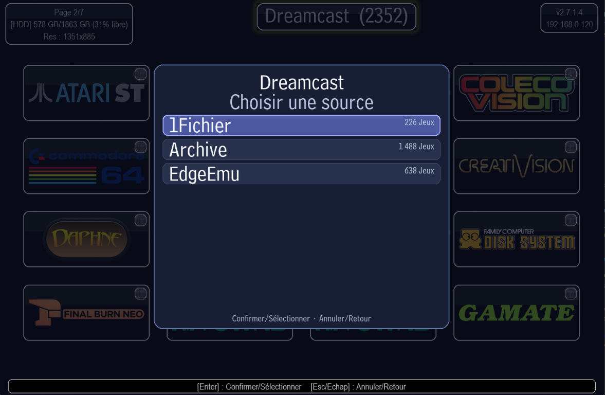
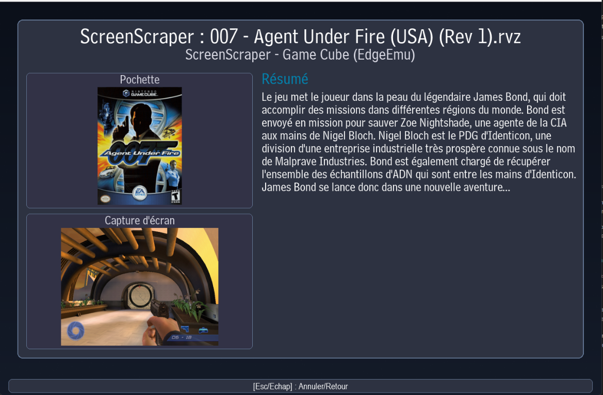

# 🎮 Retro Game Sets Xtra (RGSX)

**[Discord Desteği](https://discord.gg/XPK8YG8XYC)** • **[Kurulum](#-kurulum)** • **[İngilizce Dokümantasyon](https://github.com/RetroGameSets/RGSX/blob/main/README.md)** • **[Fransızca Dokümantasyon](https://github.com/RetroGameSets/RGSX/blob/main/README_FR.md)** • **[Sorun Giderme / Sık Karşılaşılan Hatalar](https://github.com/RetroGameSets/RGSX/blob/main/README_TR.md#%EF%B8%8F-sorun-giderme)** •

Batocera, Knulli ve RetroBat için çoklu kaynak desteğine sahip, ücretsiz ve kullanımı kolay bir ROM indiricisi.

<p align="center">
  
  
</p>
<p align="center">
  
  
</p>
<p align="center">
  
  
</p>
<p align="center">
  
  
</p>
<p align="center">
  
  
</p>


---

## 🚀 Kurulum

### Hızlı Kurulum (Batocera / Knulli / dArkOS)

**SSH veya terminal erişimi gerekir:**
```bash
curl -L bit.ly/rgsx-install | sh
```

Kurulumdan sonra:
1. Oyun listelerini güncelleyin: `Menu > Game Settings > Update game list`
2. RGSX'i **PORTS** veya **Homebrew and ports** altında bulabilirsiniz

dArkOS'ta aynı komut dArkOS kurulum script'ini çalıştırır ve EmulationStation kendiliğinden yeniden başlar: aşağıdaki [dArkOS](#darkos--darkosre--darkosen-r36s-ve-klonları) bölümüne bakın.

### Manuel Kurulum (Tüm Sistemler)
1. **İndirin**: [RGSX_full_latest.zip](https://github.com/RetroGameSets/RGSX/releases/latest/download/RGSX_full_latest.zip)
2. **Arşivden çıkarın**:
   - **Batocera/Knulli**: `ports` klasörünü `/roms/` içine çıkarın
   - **RetroBat**: `ports` ve `windows` klasörlerinin ikisini de `/roms/` içine çıkarın
3. **Yenileyin**: `Menu > Game Settings > Update game list`

### dArkOS / dArkOSRE / dArkOSen (R36S ve klonları)
**Kurulum script'i (önerilen):** [tools/install_darkos.sh](tools/install_darkos.sh) son sürümü indirir, RGSX'i `/roms/ports` içine (ikinci SD kart kullanıyorsanız `/roms2/ports` içine) kurar, diğer portlarınıza dokunmadan RGSX'i `gamelist.xml` dosyasına ekler (yedeği `gamelist.xml.rgsx-backup` olarak saklanır) ve ardından EmulationStation'ı yeniden başlatır. Güncellemek için aynı şekilde tekrar çalıştırın.
- SSH ile (`ssh ark@IPADRESI`, şifre `ark`; SSH'ı `Options > Enable Remote Services` ile açın):
  ```bash
  curl -L bit.ly/rgsx-install | sh
  ```
  curl yoksa: `wget -qO- bit.ly/rgsx-install | sh`
- Menüden: `install_darkos.sh` dosyasını `/roms/tools/` içine kopyalayın, ardından EmulationStation'da `Options` menüsünden başlatın.
- Yerel bir zip ya da klasör de kullanılabilir: `bash install_darkos.sh /yol/RGSX_full_latest.zip`

**Manuel kurulum:** [RGSX_full_latest.zip](https://github.com/RetroGameSets/RGSX/releases/latest/download/RGSX_full_latest.zip) içindeki `ports/RGSX` klasörünü `/roms/ports/` içine, `RGSX.png` / `RGSX.mp4` dosyalarını da `/roms/ports/images/` ve `/roms/ports/videos/` içine kopyalayın. Klasörleri birleştirin, asla üzerine yazıp değiştirmeyin: bu klasörlerde diğer portlarınız da bulunur. Kendi `gamelist.xml` dosyanızın üzerine başka bir `gamelist.xml` kopyalamayın. dArkOS sadece doğrudan `ports/` içindeki başlatıcıları listeler, bu yüzden `/roms/ports/RGSX.sh` dosyasını da oluşturun:
```bash
printf '#!/bin/bash\nexec "$(dirname "$0")/RGSX/RGSX.sh" "$@"\n' > /roms/ports/RGSX.sh
```
Ardından EmulationStation'ı yeniden başlatın.

Notlar:
- R36S'te dahili WiFi yoktur. OTG portuna bir USB WiFi adaptörü takın ve `Options > Wifi` üzerinden bağlanın. Adaptör ya da bağlantı bulunamazsa RGSX açılışta uyarı gösterir.
- pygame ve requests dArkOS ile birlikte gelmez. Bunlar `ports/RGSX/vendor_darkos` içinde paketlenmiştir (Debian trixie paketlerinden `tools/build_darkos_vendor.sh` ile oluşturulur ve sistemdeki SDL2'yi kullanır).
- Ayarlar ve yerel veritabanı exFAT ROM kartında değil, `/home/ark/.config/rgsx` (ext4) içinde saklanır. Media Manager kapakları çok yer kaplayabildiği için ROM kartına kaydedilir: `/roms/rgsx/media` (veya `/roms2/rgsx/media`).
- Oturum sırasında oyun eklendiyse, RGSX'ten çıktıktan sonra oyunların görünmesi için EmulationStation otomatik olarak yeniden başlar.
- A/B düğme değişimi (EmulationStation'daki "SWITCH A/B BUTTONS IN EMULATIONSTATION" ayarı veya dArkOSen'in Button Mapper aracı) RGSX açılırken otomatik olarak uygulanır.
- Torrent indirmeleri ARM cihazlarda henüz kullanılamıyor.

### Manuel Güncelleme (otomatik güncelleme başarısız olursa)
En son sürümü indirip arşivden çıkarın: [RGSX_full_latest.zip](https://github.com/RetroGameSets/RGSX/releases/latest/download/RGSX_full_latest.zip)

**Kurulum yolları:**
- `/roms/ports/RGSX` (tüm sistemler)
- `/roms/windows/RGSX` (yalnızca RetroBat)

---

## 🎮 Kullanım

### İlk Açılış

- Sistem ve oyun kataloğunu yerel bir SQLite veritabanına senkronize eder
- Arayüzün ihtiyaç duyduğu görselleri indirir
- Kontrolcünüz tanınırsa tuşları otomatik yapılandırır
- **Tuşlar çalışmıyor mu?** `/saves/ports/rgsx/controls.json` dosyasını silip yeniden başlatın

**Retrobat / Windows'ta ilk açılış**

- Her şeyin çalıştığını doğrulamak için `RGSX Retrobat.bat` dosyasını bir kez Retrobat arayüzü dışından elle başlatmanız önerilir.
- Windows güvenlik duvarı uyarıları çıktığında izin verin; özellikle ilk açılışta qBittorrent için.
- Retrobat bazı sistem pencerelerini varsayılan olarak gizler. İlk açılışı elle yapmak önemli bir uyarıyı kaçırmamanızı sağlar.
- Başlatıcı daha sonra gömülü qBittorrent ikili dosyası ve TCP `18572` WebUI portu için yerel bir kural tanımlar.

**Klavye Modu**: Kontrolcü algılanmadığında tuşlar simge yerine `[Tuş]` biçiminde gösterilir.

### Duraklatma Menüsü Yapısı

**Ana menü** — Oyunlar, Dil, Kontroller, Görünüm, Ayarlar, Destek, Varsayılan Ayarlara Sıfırla ve Çıkış.

- **Oyunlar**: kataloğu yenileyin, yerelde sahip olunan ROM'ları tarayın, indirme geçmişini açın, desteklenmeyen sistemleri gösterin/gizleyin ve görünür platformları seçin.
- **Kontroller**: geçerli tuş atamalarını görüntüleyin veya klavye/kontrolcü tuşlarını yeniden atayın.
- **Görünüm**: sekiz ızgara arasından seçim yapın (3×3, 3×4, 4×3, 4×4, 5×4, 6×4, 6×6 veya 8×6), arayüz ve alt bilgi yazı boyutlarını ayrı ayrı ayarlayın, yazı tipi (Pixel, Bell Centennial veya DejaVu Sans), arka plan teması ve Açık Mod seçin. Monitör seçimi yalnızca birden fazla ekran algılandığında görünür; pencere/tam ekran modu yalnızca Windows'ta vardır. Bilinmeyen uzantı uyarılarını da gizleyebilirsiniz.
- **Scrap**: ScreenScraper kimlik bilgilerini düzenleyin, Medya Yöneticisi'ni açın ve ScreenScraper'ı açıp kapatın (**ScreenScraper'ı etkinleştir** / **ScreenScraper'ı devre dışı bırak**). Devre dışıyken Medya Yöneticisi engellenir, çalışan indirmeler iptal edilir ve önizleme paneli gizlenir. Seçim `rgsx_settings.json` içinde `screenscraper_disabled` olarak saklanır.
- **Ayarlar**: arka plan müziği, sembolik bağlantı davranışı, otomatik arşivden çıkarma, ROM klasörü, en fazla eşzamanlı indirme sayısı, API anahtarı durumu ve bağlantı durumu. Açılışta web servisi ve Özel DNS seçenekleri Linux/Batocera'da kullanılabilir.
- **Destek**: tanılama araçları ve destek arşivi oluşturma.
- **Çıkış**: RGSX'ten çıkın veya yeniden başlatın. Dil seçimi doğrudan ana menüdedir.

### ScreenScraper ve Medya Yöneticisi

Oyun listesinde seçili oyunun yerel kapağı varsa hemen gösterilir. ScreenScraper devre dışıyken önizleme paneli gizlenir ve oyun listesi otomatik bilgi almaz. Varsayılan olarak iki saniye (`config.py` içindeki `SCREENSCRAPER_PREVIEW_DELAY_SEC`, veya `RGSX_SCREENSCRAPER_PREVIEW_DELAY` ortam değişkeni) kalındığında RGSX ScreenScraper özetini önizleme panelinde gösterir: özet yerel veritabanında zaten kayıtlıysa oradan okunur (ScreenScraper'da bulunamayan oyunlar da kaydedilir ve yeniden sorgulanmaz), değilse alınıp kaydedilir. Kapak yalnızca yerelde yoksa ve ScreenScraper'da varsa indirilir; ScreenScraper'da kapağı olmayan oyun için kapak tekrar sorulmaz. Özet yüklendiğinde panelde görünür. Bilgi bulunamazsa panelde uygun bir yer tutucu gösterilir. Öncelikli ScreenScraper sistem kimliği, çevrimiçi RGSX kataloğunda platform başına saklanır ve RGSX Sources Manager üzerinden düzenlenebilir. Kimlik tanımlı değilse RGSX, SQLite'ta düzenli güncellenen ScreenScraper sistem listesine, ardından yerleşik takma adlara geri döner. **Onayla** düğmesine iki saniye basmak, kapak, ekran görüntüsü ve özeti içeren oyun ayrıntı sayfasını açar. Bunlar önce yerel `media` klasöründen ve veritabanından okunur; ScreenScraper yalnızca yerelde eksik olanlar için sorgulanır. **Duraklat > Scrap** bölümünde ScreenScraper kullanıcı adı ve parolası aynı sayfada düzenlenir: sanal klavye yalnızca kontrolcü algılandığında görünür; aksi durumda doğrudan yazın, alanlar arasında geçmek için Tab, onaylamak için **ENTER** kullanın. Kalan kotayı bir mesaj gösterir. Hesap ayrı `saves/ports/rgsx/screenscraper_account.json` dosyasında saklanır ve Web arayüzünden de düzenlenebilir.

Medya Yöneticisi toplu indirme yapar. Profilleri **Kapak** (`default`) ve **Kapak + Ekran Görüntüsü + Özet** (`max`)'tir. Her oyun bir detay isteği ve medya türü başına bir istek harcar: Kapak için 2, tam profil için 3 istek (tahminde gösterilir). Yerelde zaten bulunan dosyalar ve özetler, ScreenScraper'da bulunamayanlar dahil, yeniden istenmez. **Geçmiş** kontrol kısayolu, ilk satıra dönmeden işi başlatır, sürdürür veya iptal eder.

### Yerel Veritabanı ve Taşıma

Sistem/oyun kataloğu, indirme geçmişi, yerelde algılanan sahip olunan oyunlar, ScreenScraper özetleri ("bulunamadı" yanıtları dahil) ve ilgili kalıcı veriler `/saves/ports/rgsx/rgsx.sqlite3` içinde saklanır. İlk katalog senkronizasyonu tam bir anlık görüntü indirir; sonraki senkronizasyonlar yalnızca değişiklikleri uygular. Bir kaynak veya platform gizlendiğinde ya da yeniden etkinleştirildiğinde RGSX görünür platform listesini günceller ve yalnızca yeni görünür olan platformların oyun verilerini aktarır. **Oyunlar > Oyun Kataloğunu Yenile** senkronizasyonu yeniden çalıştırır. Genel tercihler `rgsx_settings.json` içinde, özel tuş atamaları `controls.json` içinde kalır.

Eski JSON tabanlı depolamadan yükseltme sonrası ilk açılışta RGSX; indirme geçmişini, sahip olunan oyun kayıtlarını ve varsa torrent önbelleğini içe aktarır. Bulunan eski önbellek/veri dosyaları `/saves/ports/rgsx/backup_old_rgsx/<tarih>/` klasörüne taşınır. RGSX çalışırken SQLite veritabanını silmeyin: katalog ve kalıcı kullanıcı verileri bu dosyadadır. SQLite, veritabanının yanında geçici `-wal` ve `-shm` dosyaları oluşturabilir.

---

## ✨ Özellikler

- 🎯 **Akıllı Sistem Algılama** – Desteklenen sistemleri `es_systems.cfg` dosyasından otomatik bulur
- 📦 **Akıllı Arşiv İşleme** – Sistem ZIP dosyalarını desteklemiyorsa arşivleri otomatik çıkarır
- 🔑 **Premium Kilit Açma** – Sınırsız indirme için 1Fichier API + AllDebrid/Debrid-Link/Real-Debrid/TorBox yedeği
- 🎨 **Tamamen Özelleştirilebilir** – 8×6'ya kadar sekiz düzen, Pixel/Bell Centennial/DejaVu Sans yazı tipleri, yazı boyutları (arayüz + alt bilgi), diller (EN/FR/DE/ES/IT/PT/TR)
- 🎮 **Kontrolcü Odaklı Tasarım** – Popüler kontrolcüler için otomatik tuş atama + özel tuş atama desteği
- 🔍 **Gelişmiş Filtreleme** – Ada göre arama, desteklenmeyen sistemleri gösterme/gizleme, platform filtreleme
- 📊 **İndirme Yönetimi** – Kuyruk sistemi, geçmiş takibi, ilerleme bildirimleri
- 🖼️ **ScreenScraper Medyaları** (Duraklat > Scrap üzerinden kapatılabilir) – Gecikmeli kapak indirme, oyun ayrıntıları, ekran görüntüleri ve toplu medya yönetimi
- ♿ **Erişilebilirlik** – Arayüz ve alt bilgi için ayrı yazı ölçekleme, yalnızca klavye modu desteği

> ### 🔑 API Anahtarı Kurulumu
> Sınırsız 1Fichier indirmeleri için API anahtar(lar)ınızı `/saves/ports/rgsx/` içine ekleyin:
> - `1FichierAPI.txt` – 1Fichier API anahtarı (önerilir)
> - `AllDebridAPI.txt` – AllDebrid yedeği (isteğe bağlı)
> - `DebridLinkAPI.txt` – Debrid-Link yedeği (isteğe bağlı)
> - `RealDebridAPI.txt` – Real-Debrid yedeği (isteğe bağlı)
> - `TorBoxAPI.txt` – TorBox yedeği (isteğe bağlı)
> 
> **Her dosya YALNIZCA anahtarı içermelidir, başka metin olmamalıdır.**

### Oyun İndirme

1. Platformlara göz atın → Oyun seçin
2. **Doğrudan İndirme**: `Confirm` tuşuna basın
3. **Kuyruğa Ekleyerek İndirme**: `X` (Batı tuşu) tuşuna basın
4. İlerlemeyi **Geçmiş** menüsünden veya açılır bildirimlerden takip edin

## Gömülü qBittorrent torrent altyapısı

Torrent indirmeleri artık hem Windows'ta hem Linux/Batocera'da gömülü bir qBittorrent ikili dosyası üzerinden çalışır.

- Yerel ağ hata ayıklama WebUI'si: `http://CIHAZ_IP_ADRESI:18572`
- Varsayılan kimlik bilgileri: `admin` / `RGSXqbt`
- RGSX web arayüzünde bu WebUI'yi doğrudan açan bir `qBittorrent` düğmesi bulunur.

Faydalı notlar:
- Bu WebUI, aynı yerel ağdaki bir telefondan veya başka bir bilgisayardan hata ayıklama ve gelişmiş torrent takibi için tasarlanmıştır.
- WebUI'ye yerel ağdan erişilemiyorsa önce Windows güvenlik duvarını kontrol edin.
- `18572` portunu doğrudan internete açmayın: bu, BitTorrent performans portu değil, WebUI yönetici portudur.
- Torrent bağlantısı zayıfsa UPnP kullanın veya qBittorrent içinde yapılandırılan asıl BitTorrent dinleme portunu yönlendirin.

## 🌐 Web Arayüzü (Yalnızca Batocera/Knulli)

RGSX, ağınızdaki herhangi bir cihazdan uzaktan oyunlara göz atmak ve indirmek için RGSX kullanılırken otomatik başlayan bir web arayüzü içerir.

### Web Arayüzüne Erişim

1. **Batocera IP adresinizi bulun**:
   - Batocera menüsüne bakın: `Network Settings`
   - Veya terminalden: `ip addr show`

2. **Tarayıcıda açın**: `http://[BATOCERA_IP]:5000` veya `http://BATOCERA:5000`
   - Örnek: `http://192.168.1.100:5000`

3. **Her cihazdan erişilebilir**: Aynı ağdaki telefon, tablet, bilgisayar

### Web Arayüzü Özellikleri

- 📱 **Mobil Uyumlu** – Duyarlı tasarım her ekran boyutunda çalışır
- 🔍 **Tüm Sistemlere Göz Atma** – Tüm platformları ve oyunları görüntüleyin
- ⬇️ **Uzaktan İndirme** – İndirmeleri doğrudan Batocera'nıza kuyruğa ekleyin
- 📊 **Anlık Durum** – Etkin indirmeleri ve geçmişi görün
- 🎮 **Aynı Oyun Listeleri** – Ana uygulamayla aynı kaynakları kullanır


### Açılışta Web Servisini Etkinleştirme/Devre Dışı Bırakma (RGSX'i başlatmaya gerek kalmadan)

**RGSX Menüsünden**
1. **Duraklatma Menüsünü** açın (Start/ALTGr)
2. **Ayarlar > Web Servisi** bölümüne gidin
3. **Açılışta Etkinleştir** seçeneğini açıp kapatın
4. Cihazınızı yeniden başlatın


**Port Yapılandırması**: Web servisi varsayılan olarak `5000` portunda çalışır. Bu portun güvenlik duvarı kurallarınca engellenmediğinden emin olun.

---

## 📁 Dosya Yapısı

```
/roms/
├── ports/
│   ├── RGSX/
│   │   ├── __main__.py                # Giriş noktası
│   │   ├── config.py                  # Uygulama yolları ve yapılandırma
│   │   ├── database.py                # Yerel SQLite depolama
│   │   ├── catalog_sync.py            # Çevrimiçi katalog senkronizasyonu
│   │   ├── controls.py                # Gezinme, girdi ve eylemler
│   │   ├── controls_mapper.py         # Kontrol profilleri ve tuş atama
│   │   ├── display.py                 # Pygame arayüzü ve menüler
│   │   ├── game_info.py               # ScreenScraper ayrıntılarını alma
│   │   ├── media_manager.py           # Toplu medya indirmeleri
│   │   ├── network.py                 # İndirmeler
│   │   ├── preview.py                 # Oyun listesi kapak önizlemesi ve gecikmeli indirme
│   │   ├── rgsx_settings.py           # Kullanıcı tercihleri
│   │   ├── screenscraper.py           # ScreenScraper API istemcisi
│   │   ├── rgsx_web.py                # Web arayüzü ve sunucu
│   │   ├── assets/                    # Profiller, görseller, yazı tipleri, müzik ve araçlar
│   │   ├── languages/                 # Çeviriler (EN/FR/DE/ES/IT/PT/TR)
│   │   ├── static/                    # Web arayüzü CSS ve JavaScript
│   │   └── logs/                      # RGSX.log ve rgsx_web.log
│   ├── gamelist.xml
│   ├── images/
│   └── videos/
└── windows/
    ├── RGSX Retrobat.bat              # Yalnızca Windows için başlatıcı (Retrobat olmadan da kullanılabilir)
    ├── gamelist.xml
    ├── images/
    └── videos/

/saves/ports/rgsx/
├── rgsx_settings.json        # Kullanıcı tercihleri
├── controls.json             # Tuş atamaları
├── rgsx.sqlite3 # Katalog, geçmiş, ScreenScraper özetleri ve kalıcı kullanıcı verileri
├── images/                   # Sistem görselleri
├── media/                    # Oyun kapaklarının ve ekran görüntülerinin önbelleği
├── screenscraper_account.json # İsteğe bağlı ScreenScraper hesabı
├── backup_old_rgsx/          # Taşıma sırasında arşivlenen eski dosyalar (varsa)
├── 1FichierAPI.txt           # 1Fichier API anahtarı
├── AllDebridAPI.txt          # AllDebrid API anahtarı
├── DebridLinkAPI.txt         # Debrid-Link API anahtarı
├── RealDebridAPI.txt         # Real-Debrid API anahtarı
└── TorBoxAPI.txt              # TorBox API anahtarı
```

`rgsx.sqlite3` yanında görünebilen `-wal` ve `-shm` dosyaları, uygulama çalışırken SQLite'ın kullandığı geçici dosyalardır.

---

## 🛠️ Sorun Giderme

| Sorun | Çözüm |
|-------|-------|
| Tuşlar çalışmıyor | `/saves/ports/rgsx/controls.json` dosyasını silip uygulamayı yeniden başlatın; /roms/ports/RGSX/assets/controls/xx.json dosyasını silmeyi de deneyebilirsiniz |
| Oyun yok veya katalog boş mu? | **Oyunlar > Oyun Kataloğunu Yenile**'yi açın, ardından **Oyunlar > Platformları Filtrele**'yi ve desteklenmeyen sistemlerin görünürlük seçeneğini kontrol edin. **Ayarlar**'da yapılandırılmış ROM klasörünün doğru olduğunu doğrulayın. Senkronizasyon başarısız olursa Bağlantı Durumu'nu kontrol edin. |
| Listede eksik sistemler mi var? | RGSX sistemleri emülatör yapılandırmasından bulur. **Oyunlar** altında desteklenmeyen sistemlerin görünürlüğünü açın ve platform filtresini kontrol edin. |
| Katalog senkronizasyonu veya veritabanı yazma hatası | `/saves/ports/rgsx/` içinde boş disk alanını ve yazma izinlerini kontrol edin, ardından logları inceleyin. `rgsx.sqlite3` dosyasını yedeksiz silmeyin: geçmiş ve sahip olunan oyun kayıtları da bu dosyadadır. |
| Uygulama çöküyor | `/roms/ports/RGSX/logs/RGSX.log` (web sunucusu için `rgsx_web.log`) dosyasını kontrol edin. |
| ScreenScraper hatası: hesap gerekli, 403 veya kota doldu | Kendi ScreenScraper girişinizi **Duraklat > Scrap** bölümünde girin. Geliştirici kimlik bilgileri oturum başına bir kez RGSX kimlik bilgisi servisinden alınır ve yalnızca bellekte tutulur. 403, kimlik bilgilerinin reddedildiği; kota hatası ise hesabınızın günlük limitinin dolduğu anlamına gelir. |
| Oyun listesinde kapaklar eksik | ScreenScraper devre dışıysa önizleme paneli (kapak ve özet) gizlenir. **Duraklat > Scrap** bölümünden yeniden etkinleştirin. |
| Düzen değişikliği uygulanmadı | Düzeni değiştirdikten sonra RGSX'i yeniden başlatın |
| Bazı oyunları indirmede sorun mu var? | Duraklatma Menüsü > Ayarlar > Bağlantı Durumu'nu açın. Gerekli sitelerden biri veya birkaçı kırmızıysa Ayarlar'dan Özel DNS'i etkinleştirip yeniden başlatın. İnternet sağlayıcısı/modem korumalarını da kontrol edin (özellikle ASUS web tehdit engelleme). |

**Yardım mı lazım?** `/roms/ports/RGSX/logs/` içindeki logları [Discord](https://discord.gg/XPK8YG8XYC) üzerinden paylaşın.

---

## 🤝 Katkıda Bulunma

- **Hata Bildirimleri**: Loglarla birlikte GitHub issue açın veya Discord'a yazın
- **Özellik İstekleri**: Önce Discord'da tartışın, sonra issue açın
- **Kod Katkıları**: 
  ```bash
  git checkout -b feature/your-feature
  # Batocera/RetroBat üzerinde test edin
  # Pull Request gönderin
  ```

---

## 📝 Lisans

Ücretsiz ve açık kaynaklı yazılım. Özgürce kullanın, değiştirin ve dağıtın.

## Tüm katkıda bulunanlara ve bu uygulamayı takip edenlere teşekkürler

**Projemi desteklemek isterseniz bana bir bira ısmarlayabilirsiniz :  https://bit.ly/donate-to-rgsx**
<a href="https://github.com/RetroGameSets/RGSX/graphs/contributors">
  
</a>
[](https://starchart.cc/RetroGameSets/RGSX)

**Retro oyun topluluğu için ❤️ ile geliştirildi.**
